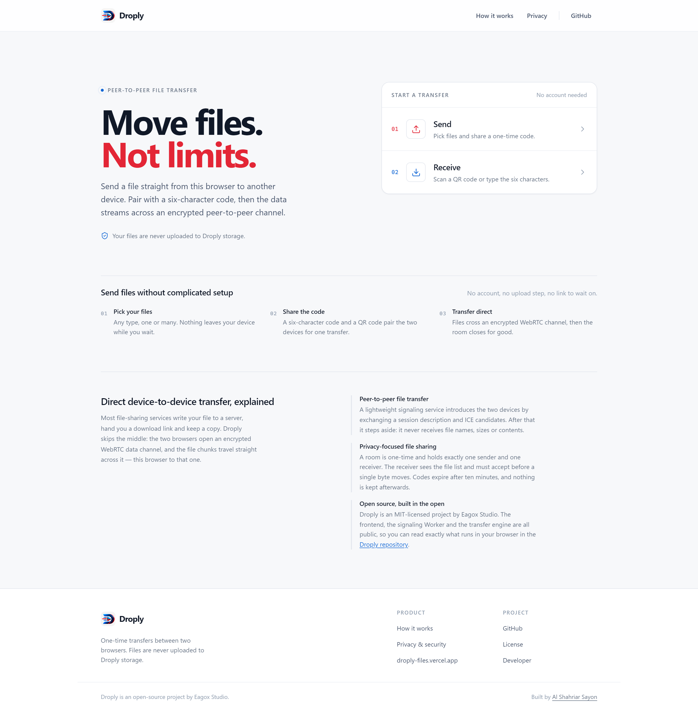
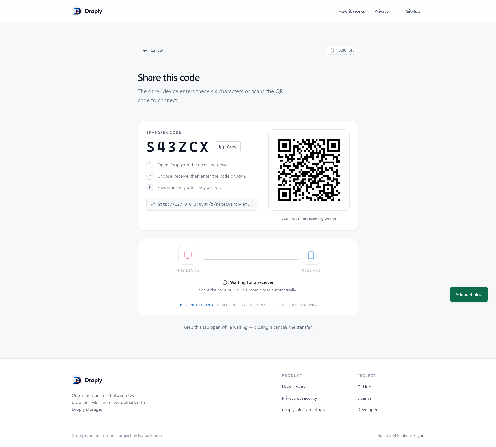
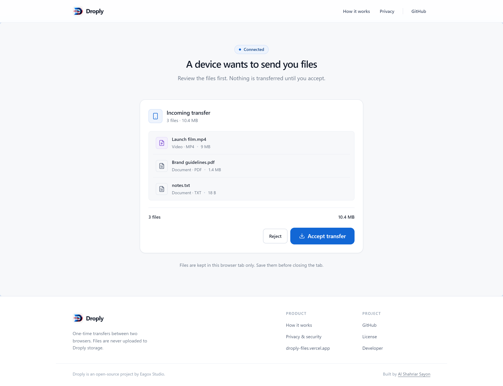
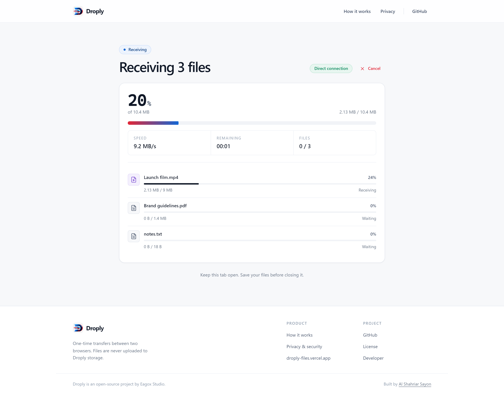
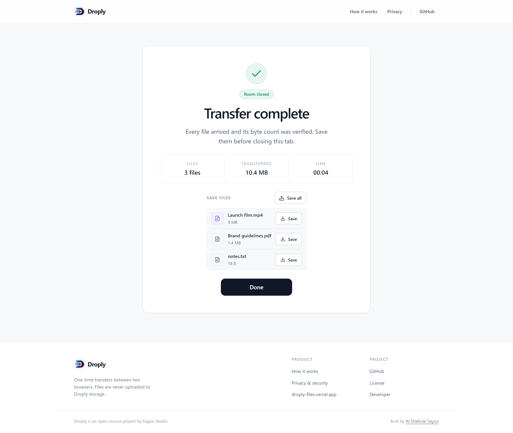
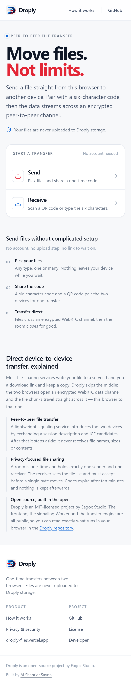

# Droply

**Move files. Not limits.**

Droply is a browser-based, one-time peer-to-peer file transfer app. Two devices pair with a
six-character code or a QR scan, negotiate a direct WebRTC connection, and stream file bytes to each
other. Files are never uploaded to Droply — the signaling service only relays connection metadata.

- **Live app:** https://droply-files.vercel.app
- **Repository:** https://github.com/Alshahriar-07/Droply
- **Made by:** [Eagox Studio](https://alshahriarsayon.vercel.app/) · [Developer portfolio](https://alshahriarsayon.vercel.app/)

---

## Features

| | |
|---|---|
| **No accounts** | Nothing to sign up for, no transfer history, no tracking profiles. |
| **No storage** | File contents never touch Droply, Cloudflare, or any object store. |
| **Six-character pairing** | Cryptographically random, ambiguity-free codes (`A–H`, `J–N`, `P–Z`, `2–9`). |
| **QR handoff** | The sender displays a QR code; the receiver scans it in-browser with the camera. |
| **Multiple files** | Send many files at once, including empty files and files over 1 GB. |
| **Chunked streaming** | Files are read with `File.slice()` and streamed in 32 KiB chunks, so a 5 GB file never becomes a 5 GB allocation. The receiver folds chunks into Blob blocks every 16 MB instead of holding the file in a JS array. |
| **Backpressure control** | The sender watches `bufferedAmount` and pauses above the high-water mark. |
| **Real progress** | Per-file and overall progress, speed and ETA come from bytes that actually crossed the data channel — never from a timer. |
| **Receiver consent** | The receiver sees file names, sizes and totals and must accept before any file data flows. |
| **One-time rooms** | Rooms close on completion, cancellation, or expiry (10 minutes by default). |
| **Honest failure** | Symmetric NAT, blocked ICE, a closed tab or a rejected transfer each produce a specific, actionable error instead of a silent hang. |
| **Device profiles** | Every browser gets a stable name and avatar on first open (`Windows-3141`), shown consistently in pairing, Nearby, Saved Devices and transfers. Both parts are editable. |
| **Nearby devices** | Opt-in discovery of Droply browsers on the same network, with explicit start/stop and a two-minute presence lease. |
| **Saved devices** | Pair two browsers once with a six-character code, then send to them again without typing a new code. Every request still needs approval. |
| **Desktop + mobile** | Designed and verified from 360 px to 1920 px, portrait and landscape. |

## Screenshots

| Home | Send & pair |
|---|---|
|  |  |

| Receiver consent | Live transfer |
|---|---|
|  |  |

| Complete | Mobile |
|---|---|
|  |  |

## How Droply works

1. **The sender picks files** and creates a one-time room. The signaling Worker mints a six-character
   code plus a short-lived bearer token, and a Durable Object holds the room.
2. **The receiver joins** by entering the code or scanning the QR code (which encodes
   `/#/receive?code=CODE`). The room accepts exactly one sender and one receiver.
3. **Both browsers negotiate** a peer connection: the sender creates an offer, the receiver answers,
   and ICE candidates are exchanged over the room WebSocket. Only SDP and ICE travel through the
   server.
4. **The receiver approves** the manifest (names, types, sizes). Nothing has been transferred yet.
5. **The sender streams** each file in ordered 32 KiB chunks over a reliable, ordered data channel,
   pausing whenever the send buffer is saturated. The receiver writes chunks into a growing
   `Blob` per file.
6. **Completion** is verified by byte count on the receiver, then the DataChannel and socket are
   closed and the room is deleted.

### What leaves your device

Only signaling metadata (SDP offer/answer and ICE candidates) reaches the server. File names, sizes,
and contents are exchanged exclusively over the encrypted WebRTC data channel — end to end between
the two browsers. See [SECURITY.md](SECURITY.md).

### Nearby devices

Discovery is opt-in and server-assisted, because a browser cannot scan a LAN. When you press
**Start discovery**, the Worker registers a short-lived presence record (two-minute lease, refreshed
by heartbeat) in a `Presence` Durable Object keyed by a **hash of your public network address**. Only
overlay devices that share that address *and* have opted in appear in the list, and the group key
never leaves the Worker. A record is deleted the moment its socket closes or its lease expires, so
nothing lingers after you leave. The list carries a random peer id, a pseudonymous device id, a
display name, a coarse device type and an availability flag — no IP address, no location, no cookies.

**Send files** creates a normal one-time room and relays an invite to the selected device over the
presence channel. The receiving browser says who asked and requires an explicit choice; the file
manifest is still reviewed and accepted separately before any byte moves. File contents never touch
the presence channel.

### Saved devices

Two browsers pair once with a six-character code — typed, pasted, or scanned as a QR link. The code
is issued by the Worker, is single-use and expires after five minutes; it is only a rendezvous, never
a user-visible credential. Each browser generates a P-256 signing key pair and a P-256 agreement key
pair with WebCrypto; the private halves are imported as **non-extractable** keys and stored in
IndexedDB, so no code path can export them. Pairing exchanges only public keys and shows a six-digit
short authentication string derived from an ECDH agreement on both screens — if the two screens
disagree, cancel. A saved record holds the device name, its public key and when you last connected.

Reconnection reuses the presence channel: **Send files** from Saved Devices creates a room and sends
an invite signed by the sender's private key. The receiver verifies that signature against the stored
public key, so a request claiming a saved device's name cannot be spoofed, and both devices still
require approval. If the other device is not reachable, Droply falls back to the normal code and QR
flow instead of pretending.

## Architecture

```
 ┌──────────────┐   WebSocket (SDP + ICE only)   ┌────────────────────────┐
 │  Sender tab  │◀──────────────────────────────▶│ Cloudflare Worker      │
 └──────┬───────┘                                │  + Durable Object/Room │
        │                                        └───────────▲────────────┘
        │  RTCDataChannel (encrypted file bytes)             │
        ▼                                                    │
 ┌──────────────┐   WebSocket (SDP + ICE only)                │
 │ Receiver tab │◀────────────────────────────────────────────┘
 └──────────────┘
```

- **Frontend** — static HTML/CSS/ES modules. No framework, no bundler, no build step. Deployed to
  Vercel.
- **Signaling** — a single Cloudflare Worker plus two Durable Objects: `Room` (per-transfer
  coordination, WebSocket fan-out, room TTL) and `RateLimiter` (token-bucket limits per IP).
  Deployed with Wrangler.
- **Transport** — WebRTC `RTCPeerConnection` + a reliable, ordered `RTCDataChannel`, with public STUN
  by default and an optional TURN relay.
- **Presence** — a third Durable Object (`Presence`) keeps one short-lived, opt-in record per device
  per hashed network address. It relays presence snapshots and invites only; it has no room state and
  never sees file data.

The two halves are independent: the frontend finds the Worker through a `<meta>` tag, and the Worker
only validates origins and relays signaling frames.

## Technologies

- HTML5, CSS3 (custom properties, no framework), vanilla JavaScript ES modules
- WebRTC: `RTCPeerConnection`, `RTCDataChannel`, ICE/STUN, optional TURN
- Web Crypto (`crypto.getRandomValues`) for room codes and tokens
- Cloudflare Workers, Durable Objects, WebSocket API
- Vendored, offline-friendly libraries: [qrcode-generator](https://github.com/kazuhikoarase/qrcode-generator),
  [jsQR](https://github.com/cozmo/jsQR), and [Lucide](https://lucide.dev) icon paths (ISC)

## Project structure

```
.
├── index.html                 # App shell, SEO metadata, dialogs
├── css/
│   ├── tokens.css             # Colour, type, space, radius, elevation, motion
│   ├── base.css               # Reset, typography, a11y utilities
│   ├── layout.css             # Shell, header, footer, screen layouts
│   ├── components.css         # Buttons, cards, code entry, progress, dialogs
│   ├── features.css           # Nearby, saved devices and pairing screens
│   └── responsive.css         # Breakpoint refinements (360 → 1920)
├── js/
│   ├── app.js                 # Boot, routes, transfer orchestration, error routing
│   ├── config.js              # Runtime config (signaling URL, ICE servers, limits)
│   ├── router.js              # Hash router
│   ├── state.js               # Session state machine
│   ├── core/
│   │   ├── signaling-client.js# Room REST calls + reconnecting WebSocket
│   │   ├── peer-connection.js # RTCPeerConnection wrapper, ICE handling
│   │   ├── data-channel.js    # Ordered channel + JSON control frames
│   │   ├── transfer-protocol.js# Manifest / accept / chunk / done message schema
│   │   ├── file-sender.js     # Chunked sender with backpressure
│   │   ├── file-receiver.js   # Reassembly, verification, progress
│   │   ├── transfer-stats.js  # Byte counters, speed, ETA
│   │   ├── errors.js          # Error catalog + signaling-code mapping
│   │   ├── cleanup.js         # ResourceScope: one call releases everything
│   │   ├── device-identity.js # Non-extractable signing/agreement keys, stable device id
│   │   ├── device-profile.js  # Platform/browser detection, 4-digit tag, avatar, metadata
│   │   ├── pairing.js         # Six-character pairing sessions, SAS, signed invites
│   │   ├── presence-client.js # Opt-in nearby presence + invite relay client
│   │   ├── saved-devices.js   # Saved contacts (public keys only)
│   │   └── storage/           # IndexedDB key-value adapter (+ in-memory store for tests)
│   ├── ui/                    # Screens: send/receive, nearby, saved devices, pairing, profile, errors
│   ├── utils/                 # Byte formatting, validation, speed meter, random
│   └── vendor/                # QR generation, QR scanning, icon paths
├── api/error.js               # Edge function: branded error routes with real status codes
├── worker/
│   ├── src/index.js           # Router, CORS, validation, rate limiting
│   ├── src/room.js            # Room Durable Object + RateLimiter
│   ├── src/presence.js        # Presence Durable Object (opt-in nearby discovery)
│   ├── src/pairing.js         # Pairing Durable Object (five-minute, single-use codes)
│   ├── src/util.js            # Shared JSON, token and hashing helpers
│   ├── wrangler.toml          # Worker config (binding names, vars, migrations)
│   └── package.json
├── tests/                     # Node test runners: limits, transfer engine, presence, pairing, saved devices, SEO
├── docs/
│   ├── ERRORS.md              # Every error state, its trigger and its recovery
│   ├── SEO.md                 # Metadata, sitemap and search-console setup
│   └── screenshots/
├── error.html · 404.html      # Static error documents for hosts without the app
├── robots.txt · sitemap.xml · site.webmanifest · vercel.json
└── SECURITY.md · CONTRIBUTING.md · LICENSE
```

## Local development

**Requirements:** Node.js 20+ (the test suite uses `node --test`; the signaling dev server needs
18+), npm, and a modern Chromium/Firefox/Safari browser. No build step is required for the frontend.

### 1. Run the signaling Worker

```bash
cd worker
npm install
cp .dev.vars.example .dev.vars   # allows your local frontend origin
npm run dev          # wrangler dev on http://127.0.0.1:8787
```

The Worker needs no credentials for local development — Durable Objects run in the local Miniflare
runtime. `wrangler.toml` only allows the production origin, so `.dev.vars` (git-ignored) is what lets
a locally served frontend call the local Worker.

### 2. Run the frontend

Serve the repository root over HTTP (ES modules and camera access both require it):

```bash
npx serve . -l 3000
# or: python -m http.server 3000
```

Then open http://localhost:3000. On `localhost`, `js/config.js` automatically points at the
signaling Worker on port `8787` (the shipped meta tag targets the deployed Worker, and is used for
every other host), so both halves work with no further configuration. To point a local build at a
different Worker, add `?signaling=https://your-worker.workers.dev` to the URL.

> Open the site in **two different browsers** (or one normal and one private window) to test a real
> transfer — two tabs of the same profile share storage but still work; the transfer itself is
> per-tab.

### 3. Useful checks

```bash
npm test                     # full suite: limits, transfer engine, presence, pairing, saved devices, SEO
cd worker && npm run check   # syntax-check the Worker sources
node --check js/app.js       # syntax-check any frontend module
```

## Configuration

The frontend is configured at runtime, so a fork or a self-hosted deployment can be retargeted
without rebuilding. Edit the `<meta>` tags in `index.html` (or `js/config.js` for defaults):

| Meta tag | Purpose |
|---|---|
| `droply-signaling` | Base URL of the signaling Worker. Ships with the production Worker; a page served from `localhost` / `127.0.0.1` uses that host's port `8787` instead. Empty = same origin (`/api/*` reverse proxy). |
| `droply-turn-url` | Comma-separated TURN URLs (optional; `turn:` / `turns:`). |
| `droply-turn-username` | TURN username. |
| `droply-turn-credential` | TURN credential. |

The Worker is configured in `worker/wrangler.toml`:

| Variable | Default | Purpose |
|---|---|---|
| `ALLOWED_ORIGINS` | `*` | Comma-separated browser origins allowed to call the API. **Set this before deploying.** |
| `ROOM_TTL_SECONDS` | `600` | Waiting-room lifetime (clamped to 120–3600). |

See [`.env.example`](.env.example) for a copy-paste template covering both.

Frontend limits (file count, per-file and total size, chunk size, stall/connect timeouts) live in
`js/config.js`. The defaults are 200 files, 5 GB (5,368,709,120 bytes) per file and 5 GB for the
whole transfer, and 32 KiB chunks.

## Deployment

### Frontend → Vercel

The frontend is static. Import the repository into Vercel and use:

- **Framework preset:** Other
- **Build command:** *(none)*
- **Output directory:** `.` (repository root; `vercel.json` also sets this)

Keep the `api/` directory in the deployment: `api/error.js` is what gives the branded error routes
real HTTP status codes.

The signaling endpoint is already configured in `index.html`:

```html
<meta name="droply-signaling" content="https://droply-signaling.alshahriarsayon425.workers.dev" />
```

For a fork, either change that URL, reverse-proxy `/api/*` from the same domain and leave the tag
empty, or pass `?signaling=https://your-worker.workers.dev` for a one-off. A deployed build and the
Worker must agree: the Worker's `ALLOWED_ORIGINS` has to list the site's origin, otherwise every
request is answered with `403 origin_rejected`.

The official deployment uses https://droply-files.vercel.app.

### Signaling → Cloudflare Workers

```bash
cd worker
npm install
npx wrangler login
# 1. Edit wrangler.toml: set ALLOWED_ORIGINS to your frontend origin(s)
# 2. Deploy
npm run deploy
```

Then update the `droply-signaling` meta tag (or the reverse proxy) to the deployed Worker URL. The
health endpoint is `GET /api/health`. The `Presence` Durable Object is added by migration `v2`, which
`wrangler deploy` applies automatically on the first deploy after pulling this change.

HTTPS/WSS is required in production: browsers block camera access and WebRTC outside a secure
context (localhost is the only exception).

### Optional TURN relay

Direct connections fail on symmetric NAT and some corporate networks. To add a relay, fill in the
three `droply-turn-*` meta tags with credentials from any TURN provider. Nothing else changes — the
relay forwards encrypted WebRTC packets and still never sees plaintext.

## Security & privacy

- No accounts, no analytics, no cookies, no transfer history, no file storage.
- File data is DTLS-encrypted by WebRTC and never passes through the signaling service.
- Rooms are single-use, hold at most one sender and one receiver, and expire automatically.
- Room codes are generated with `crypto.getRandomValues`; each is paired with a short-lived token so
  a guessed code alone cannot hijack a pair.
- The Worker validates origin, payload shape and size on every request, rate-limits room creation and
  join attempts, and rejects extra participants.
- The receiver must consent before the manifest is followed by any file bytes.
- Nearby presence is opt-in, expires two minutes after the last heartbeat, disappears when the tab
  closes, and publishes only a display name, a coarse device type and pseudonymous ids.
- Saved devices store public keys only. Private keys are non-extractable WebCrypto handles in
  IndexedDB, and an invite is signature-verified before its sender is even offered to the user.

Full policy and threat model: [SECURITY.md](SECURITY.md).

## Error handling

Every failure Droply can hit is described once in `js/core/errors.js`: a reference code such as
`DL-RTC-02`, a plain-language explanation, concrete recovery steps, and semantic action ids. The UI
only renders an action when it has a working handler, so there is no dead "Retry" button, and the
same copy is used by full-page errors, inline errors beside the code input and toasts.

- Signaling error codes are mapped in one table (`SIGNALING_ERROR_MAP`), so the Worker's vocabulary
  never leaks into user-facing text.
- Branded HTTP routes (`/403`, `/410`, `/429`, `/500`, `/502`, `/503`, `/504`) are served by
  `api/error.js` with the **real** status code rather than a 200, and every error surface is
  `noindex`.
- Unexpected exceptions receive a short diagnostic id that is safe to quote in an issue; stack
  traces, room codes and file contents are never shown.

The complete list — trigger, message, recovery and whether a retry can help — is in
[docs/ERRORS.md](docs/ERRORS.md).

## Search visibility

- Canonical host: **https://droply-files.vercel.app/**. Only the homepage is indexable; transfer
  routes live in the URL fragment and never reach a crawler.
- `robots.txt` and `sitemap.xml` are at the domain root; metadata, Open Graph, Twitter card and
  JSON-LD (WebSite, Organization, SoftwareApplication) are in `index.html`.
- Error routes and the signaling API are excluded and carry `noindex` headers.
- Verification tokens are intentionally absent — see [docs/SEO.md](docs/SEO.md) for where to add your
  own.

## Known limitations

- **No TURN relay is configured by default.** Peers on symmetric NAT or restrictive firewalls may not
  be able to connect; Droply reports the failure rather than falling back to an upload.
- **Both browsers must stay open** for the duration of the transfer. Closing the sender tab cancels it.
- **Received files are assembled in Blob blocks on the receiver** (16 MB at a time, so the JS heap
  stays small), then saved through Blob downloads. The browser's Blob storage must still hold the
  whole file until the download finishes, which means a real 5 GB transfer needs that much free
  memory/disk on the receiving device. Transferring 5 GB has not been verified on real devices.
- **Rooms expire after 10 minutes** while waiting for a receiver (configurable up to 60 minutes).
- **Nearby Devices cannot scan your Wi-Fi directly.** A browser has no LAN discovery API, so Droply
  groups opt-in devices by the public address the Worker sees. Devices behind the same router meet; a
  guest network, a VPN, or carrier-grade NAT that splits addresses will not. True link-local
  discovery would need a companion app or a local service, which this build deliberately does not
  ship. QR pairing and six-character codes always remain available.
- **Saved-device reconnection needs both tabs open**, with reachability enabled on the receiving
  device. There is no push channel: if the other device is closed, use the code or QR flow.
- **Pairing needs a six-character code.** Type it, paste a pairing link, or press "Scan their QR"
  (the camera is only requested then). Codes are unique, single-use and expire after five minutes.
  Browsers without WebCrypto (`crypto.subtle`) or IndexedDB cannot save devices.
- **Six-character codes are short by design.** They are rate-limited and single-use, but a code should
  still be shared privately rather than broadcast.
- **Mobile Safari** may suspend background tabs; keep Droply in the foreground while transferring.
- No resumable transfers across a disconnect and no multi-receiver fan-out. Both are out of scope for
  a one-time two-device transfer.

## Contributing

Issues and pull requests are welcome. Please read [CONTRIBUTING.md](CONTRIBUTING.md) first — it covers
the coding style, the manual transfer test, and how to keep real functionality intact.

## License

[MIT](LICENSE) © Eagox Studio

Third-party notices for the vendored libraries are in
[`js/vendor/QRCODE-GENERATOR-README.md`](js/vendor/QRCODE-GENERATOR-README.md),
[`js/vendor/JSQR-README.md`](js/vendor/JSQR-README.md) and
[`js/vendor/LUCIDE-LICENSE.txt`](js/vendor/LUCIDE-LICENSE.txt).

---

Droply is an open-source project by **Eagox Studio**. Built by
[Al Shahriar Sayon](https://alshahriarsayon.vercel.app/).
